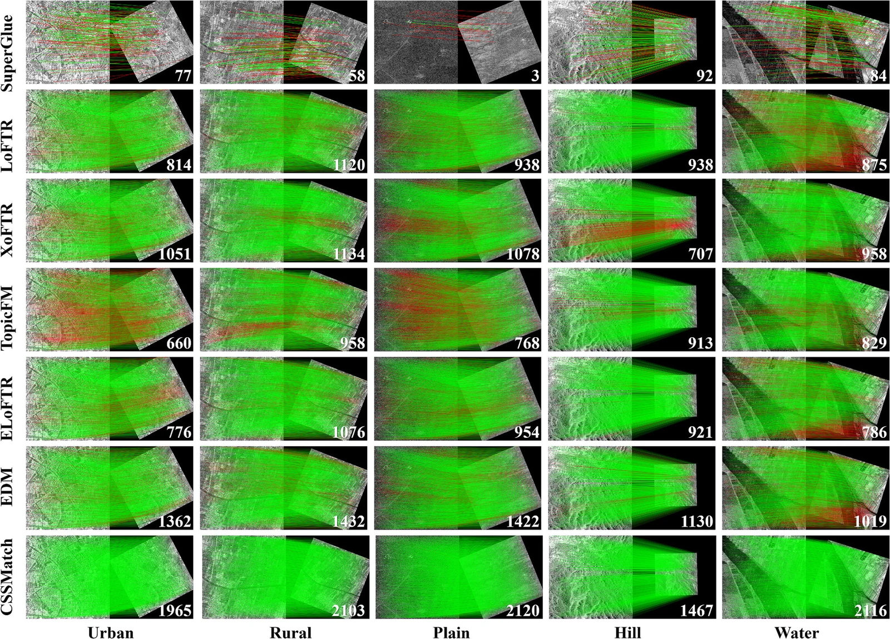

# CS-Bench

**CS-Bench** is a benchmark for C/S-band SAR image matching. It includes **CS-Bench** (9,000 real image pairs) and **CS-Bench-Syn** (450,000 synthetic image pairs).

🎉 Our paper, [A robust method for high-resolution C/S-band SAR image matching via pseudo-modality generation and coupled spectrum-spatial learning](https://doi.org/10.1016/j.rse.2026.115612), was accepted by *Remote Sensing of Environment* on 5 August 2026 and published online on 9 August 2026.

📥 **[Apply for dataset access](https://ucas20222027.github.io/CS-Bench/)** · [Contact the authors](mailto:songmingyang22@mails.ucas.ac.cn)



*Matching examples after pre-training on CS-Bench-Syn and fine-tuning on CS-Bench (Fig. 5 in Song et al., 2026).*

## 📚 Citation

If you use CS-Bench or CS-Bench-Syn in your research, please cite our paper.

```bibtex
@article{song2026csbench,
  author  = {Song, Mingyang and Zhang, Hong and Fan, Yukun and Tian, Lu and
             Liu, Yuzhou and Xie, Yazhe and Ding, Yinhaibing},
  title   = {A robust method for high-resolution {C/S}-band {SAR} image matching via pseudo-modality generation and coupled spectrum-spatial learning},
  journal = {Remote Sensing of Environment},
  year    = {2026},
  volume  = {345},
  pages   = {115612},
  doi     = {10.1016/j.rse.2026.115612}
}
```
